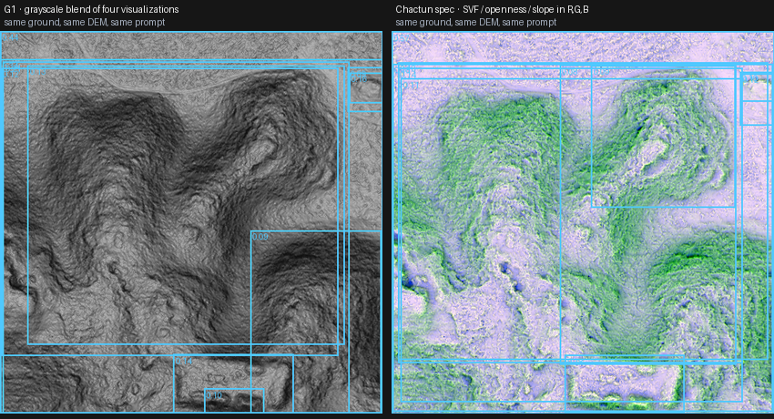
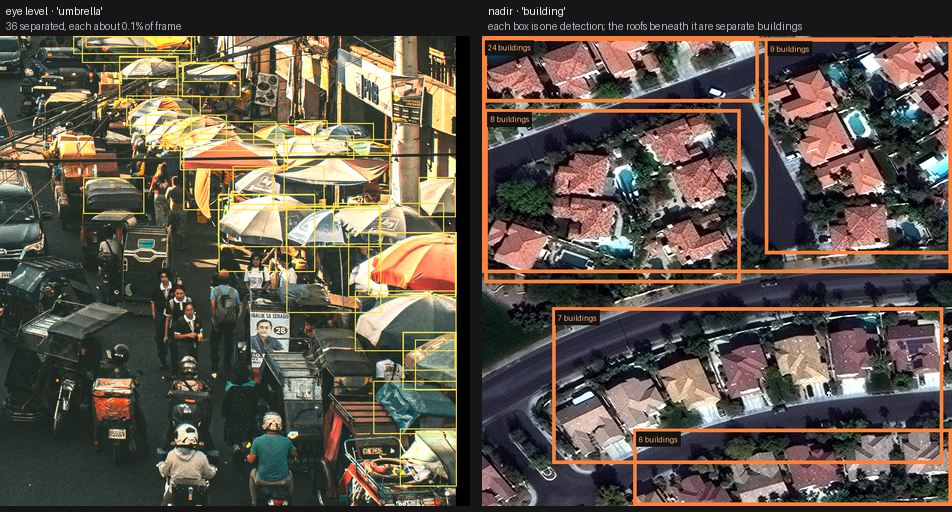
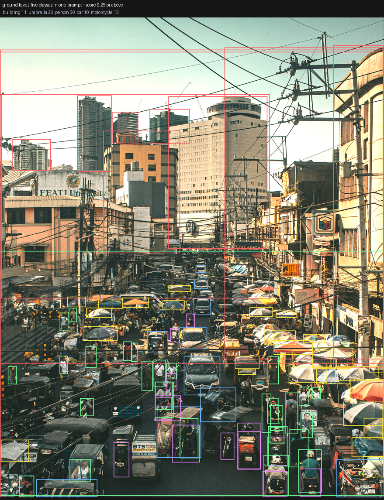
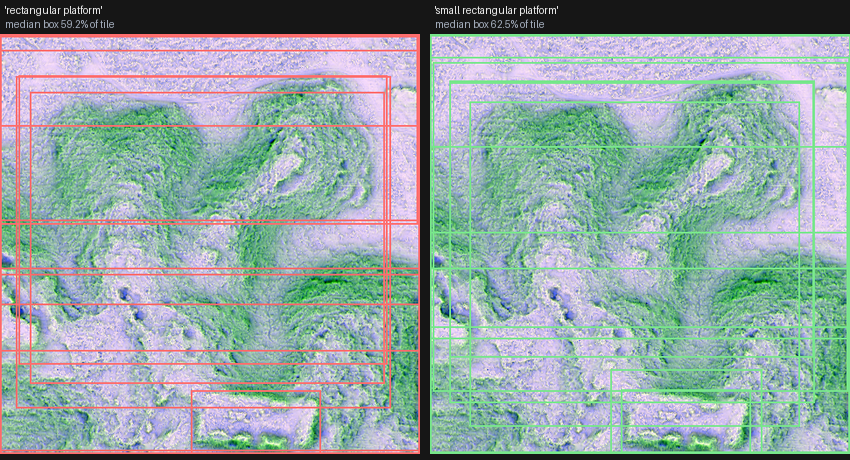
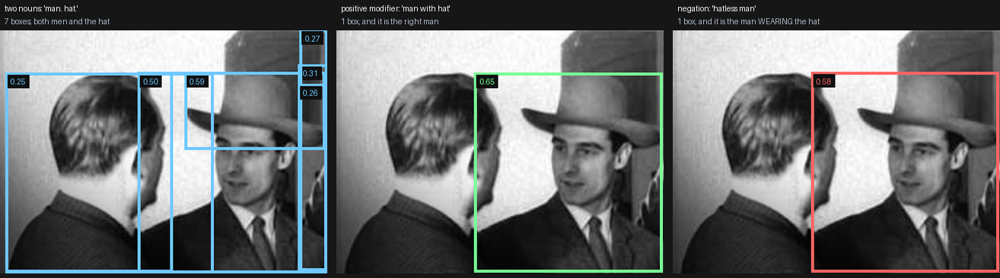

# A bird's-eye view of open-vocabulary detection: Grounding DINO and OWLv2 on aerial and lidar imagery

Grounding DINO and OWLv2 will detect anything you can name. That is the claim, and it is close enough to true that people have started pointing them at satellite and drone imagery on the strength of it. This is a measurement of what happens when you do.

Two labeled benchmarks, two model families, four prompt formulations each, every arm scored through the same COCOeval path as a supervised Mask R-CNN trained on the identical tiles. The short version: capability falls off sharply as imagery departs from the photographic distribution these models were built on, the fall-off is a gradient rather than a cliff, and how you *render* lidar moves you along that gradient further than the fact that it is lidar.

---

## What was run

**Chactún**, the ECML PKDD 2021 challenge split — 329 validation tiles, 1,614 annotations across building, platform and aguada, at 0.5 m. The imagery is a three- band composite: sky-view factor in red, positive openness in green, slope in blue, following Kokalj et al. 2023 Table 3. Three unrelated physical quantities assigned to three color channels.

**SpaceNet 2**, pooled validation — 600 images sampled from 2,118, 12,273 building annotations, 650 × 650, ordinary overhead optical from four cities.

**Models**: `IDEA-Research/grounding-dino-base` and `google/owlv2-base- patch16-ensemble`, as published, no fine-tuning.

**Protocol**: top 100 boxes per image, no score threshold, bbox AP. Masks are not scored — neither model emits them, so segmentation AP is not the comparable quantity and the supervised model's segm figure is not quoted beside these.

Predictions were registered before the runs, in `docs/milestone_d_preregistration.md`.

---

## The gradient

|  | best zero-shot | supervised | ratio |
| ---------------------------------------- | -------------------------- | ---------------------- | ---------------- |
| SpaceNet 2, overhead optical | **13.01** | 54.09 | 24% |
| Chactún, lidar composite | **3.08** | 42.33 | 7% |

Both supervised figures are bbox AP on the identical images, so the columns compare like with like.

Neither zero-shot result is a null. A size-matched random- box test — every detection replaced by a box of the same area and aspect ratio, placed at random inside the same image, keeping its score and label, twenty draws — puts every one of the sixteen arms above its own null by between 12 and 2,600 standard deviations. The models are placing boxes on image content, not guessing.

But the null sits at 0.00 to 0.09 AP, because ground-truth objects are small and a randomly placed box almost never reaches IoU 0.5. Clearing that bar establishes that localization is not random. It does not make 3.08 useful.

The third point on the gradient is not in the table because it needs no metric. On an ordinary ground-level photograph — a market street, 2859 × 3574 — the same Grounding DINO checkpoint, prompted with the five nouns building, umbrella, person, car and motorcycle, returns 90 detections at score 0.25 or above: thirty people, twenty-six umbrellas, thirteen motorcycles, eleven buildings and ten cars, each individually boxed at a fraction of a percent of frame, scores ranking sensibly. On a pond photograph, six geese separated cleanly at 0.57–0.71.

That is the capability. It survives being pointed at a crowd. It does not survive being pointed downward.

---

## Rendering matters more than sensor

The easy conclusion from the Chactún column is that lidar derivatives do not work. That conclusion is not supported by this data, and stating it would be a category error: lidar is a measurement, not an image. What a model sees is whichever visualization you chose to compute from the point cloud, and that choice spans a large space.

Two renderings of identical ground make the point. `South_GLAS_l0s395`, a G-LiHT flight strip over the Yucatán, was cropped to nine 480 × 480 tiles at 0.5 m and rendered twice from the same DEM:

- **G1** — four visualizations (multi-hillshade, slope, sky-view factor, positive openness) blended into a single grayscale image, written as three identical bands. It reads as monochrome shaded relief.
- **Chactún spec** — the same three quantities as the Chactún composite, in separate color channels.

Same terrain, same resolution, same prompts, same budget. Grounding DINO's median top-200 box area came out at 22.95% of tile on G1 against 11.17% on spec, and expert review of the detection overlays rated the two comparable to each other and comparable to SpaceNet — with the published Chactún composite worse than either.

No AP is available for that comparison, because G-LiHT carries no per-class labels. Single-class annotations do exist, and they are sound: they were drawn conservatively by hand, so they are true positives, though some real structures were left unmarked. What they cannot support is this comparison, which needs per-class ground truth. Testing these tools against Q2000's own detections would be a different exercise again — scoring one model against another rather than against the ground. The comparison reported here is therefore a box- geometry measurement plus a qualified reader's assessment, and it is reported as such.

What that supports is narrow and worth stating precisely: **Chactún's published composite performed worst of the image types tested, and how the terrain is rendered appears to matter more than the fact that it came from lidar.** Nothing here tests textured meshes, splatmapped surfaces, local relief models, VAT, or plain hillshade. A photorealistic still image from virtual street view of a texture-mapped 3D mesh derived from a lidar point cloud might well behave like a market street rather than like Chactún.

---

## Viewpoint, and what the corpus contains

**The evidence converges on viewpoint.** These two checkpoints look undertrained on aerial vantages rather than undertrained in general, and that is the strongest reading this study supports. It is an inference from behavior: the training corpora were not inspected here, so what follows are indications rather than a demonstration. They are several, they are independent of one another, and they point the same way.

Three things vary between a market street and a Chactún tile: the viewpoint, the sensor, and how the scene is composed. Two of them can be separated here.

Hold the viewpoint constant and change the sensor. SpaceNet and Chactún are both nadir; one is optical and one is a lidar composite. The result is 24% of supervised capability against 7%. Sensor and rendering matter.

Hold the sensor roughly constant and change the viewpoint. Ordinary photographs and SpaceNet are both optical; one is taken from eye height and one from above. The result is coherent detection against 24%. Viewpoint matters, and on this evidence it matters more.

The same contrast appears inside a single capability. Instance separation on small repeated objects is something these models do well: thirty-six umbrellas individually boxed in a crowded market scene, each about a tenth of a percent of frame. Point the same checkpoint at a residential block from above, prompted with the same kind of common noun, and it stops separating: on one Las Vegas tile carrying thirty-nine annotated buildings, eight of its top boxes each span between two and twenty-four of them, and its highest-scoring box covers six. The task is identical and the competence is present; only the vantage has changed.

That points at the pretraining corpus rather than at any architectural limit. These models learned from web images captioned by people photographing what was in front of them, at roughly eye height. A building in that corpus is a facade — walls, windows, a door, a roofline against sky. From nadir the same object presents a roof, which shares almost nothing with what the word was learned on. The noun is welded to a vantage the image does not supply.

Two observations in this study fit that account and little else. Morphological descriptions beat class names on both lidar renderings, because geometry is view- invariant and a rectangle is a rectangle from any angle. And "house" outscores "building" on SpaceNet in both families, a near- synonym beating the correct class name, which is what happens when neither word is anchored to the view in front of it and the commoner one wins on frequency alone.

So the indications point to something specific. Grounding DINO and OWLv2 appear not to have been given enough aerial imagery to make them as effective from above as they demonstrably are at eye level. Nothing here implicates their architecture, their parameter count, or the sheer quantity of data they consumed — the same checkpoint that merges six buildings into one box separates thirty-six umbrellas, so the machinery is intact and the competence is present. What differs is the vantage, and a vantage is a property of the samples a model was shown. On that reading, scaling either corpus further would add samples without adding vantages, and the gap would persist through the scaling.

Three things would settle it, and none were done here. An audit of what fraction of each pretraining corpus is overhead imagery would establish the premise directly rather than by inference. A matched pair — the same scene type photographed from eye level and from above — would separate viewpoint from scene composition, which this design does not. And an open-vocabulary model trained with aerial imagery in its corpus should not show the gap; if it did, this reading is wrong and something else is going on.

The remedy that follows is viewpoint diversity. Overhead imagery paired with text is the obvious first step, and it is cheap to synthesize by captioning existing labeled remote-sensing collections. More valuable is the same object captioned from several vantages, so that the noun detaches from one canonical view. Most valuable, and most speculative, is training against three-dimensional representations of target objects and scenes, from which arbitrary viewpoints can be rendered. A model that has seen a structure from the street, from above, and from every angle between has some chance of learning what the object is rather than what one photograph of it looks like.

---

## What the words do

The prompt turns out to be a larger lever than anything else available without retraining.

**The word "house" beats the word "building".** On SpaceNet, 13.01 against 8.10 for Grounding DINO and 9.61 against 6.51 for OWLv2 — a near-synonym outscoring the class name by five AP in one family and three in the other.

**Size adjectives control box scale.** Adding the word "small" to a phrase shrank median box area in 8 of 8 comparisons across four different nouns and two renderings, and *raised* median confidence in 4 of 4:

| phrase | median box area | with "small" |
| ----------------------------------------- | --------------------------------- | ------------------------------- |
| quadrilateral platform | 39.6% / 49.2% | 17.8% / 15.0% |
| rectangular platform | 56.4% / 54.3% | 35.3% / 44.5% |
| rectangular mound | 28.1% / 49.2% | 13.1% / 10.0% |
| annular object | 10.5% / 10.0% | 5.8% / 5.0% |

One adjective, independent of the noun, in both encodings.

**Compositional phrases do worse than compact ones.** Adding a qualifier and a spatial relation — "roughly quadrilateral platform on sloped terrain" against "quadrilateral platform" — pushed median box area from 39.6% to 54.2%. The extra words made the description more accurate and the detection worse. These text encoders bag content words and drop relations, so the information that distinguishes an archaeological feature is often exactly the information the encoder discards.

The workaround is lexicalization: find a single word that already contains the relation. "Annular object" encodes circular-with-a-ring in one token and was the tightest- scoring prompt of five tested on the G-LiHT tiles.

**A prediction that failed.** If nouns are bound to canonical viewpoints, then "rooftop" — what a nadir image of a building actually shows — should beat "building". It held for OWLv2 (8.11 against 6.51) and failed for Grounding DINO (6.98 against 8.10). The prediction was registered before the run and is reported as it occurred experimentally, perhaps because the referenced image was an aerial view of the rooftops and buildings together.

---

## The second deficit: descriptive comprehension

**A model that cannot hold a description cannot be prompted into competence.** Viewpoint is one gap; how these checkpoints read language is another, and the evidence for it is independent of anything about vantage. It is also more specific than it first appears. Structure between words is not uniformly lost. Some of it is read correctly, some is diluted away, and one kind of it comes back inverted.

**Positive modification works.** A photograph of two men, one wearing a hat. Prompted with "man. hat." the model returns seven boxes covering both men and the hat. Prompted with "man with hat" it returns one box, at 0.654, and it is the correct man, overlapping his reference box at 0.99. The modifier selected between two candidates of the same class. That is compositional reading, and it happened.

**Negation inverts.** The same image, prompted with "hatless man", returns one clean box at 0.577 on the man who is wearing the hat. "Man without hat" does the same. The bare-headed man is in frame, unmistakable, and is not returned. This is not a miss: a miss leaves you with nothing and you know it. An inversion hands back a confident box on the opposite of what was asked, and nothing in the output distinguishes the two.

**Content-free tokens dilute.** "A dog on a skateboard" returns three boxes with a top score of 0.506. Remove the two articles and "dog on skateboard" returns one box at 0.811 — the highest-scoring and cleanest result of seven phrasings tried on that image. The preposition is not the problem; it survives fine. Two words carrying no visual meaning spread the phrase's similarity across more tokens and cost half the confidence. The same effect showed up on the archaeological prompts, where "roughly quadrilateral platform on sloped terrain" produced median boxes at 54.2% of tile against 39.6% for "quadrilateral platform".

**And a near-synonym can outrank the correct class name.** On SpaceNet, "house" beats "building" by five AP for Grounding DINO and three for OWLv2. On a street-level photograph with both words in one prompt, "building" took zero boxes because "house" claimed every one. Two words for the same object are not separated on meaning; the commoner one wins.

**Yet single modifiers attach reliably.** "Small" shrank median box area in 8 of 8 comparisons across four nouns and two renderings, and raised median confidence in 4 of 4. A size adjective is read and acted on.

Taken together the picture is not that these encoders discard structure. It is that they handle the easy half of it. A modifier that adds a property selects correctly. A word that adds nothing visual costs confidence. A word that reverses the meaning is treated as though it added a property, which is why "hatless" finds a hat. For ordinary detection that is mostly survivable. For technical description it is not: the features that distinguish one archaeological structure from another are usually relational, often comparative, and sometimes defined by absence.

The remedy is the same shape as the viewpoint one and is equally a data question. Captions in the pretraining corpora are short, concrete and affirmative. People photograph what is there and describe what is present; almost nobody writes a caption about what a picture does not contain. So negation is close to absent from the training signal, and the encoders have had no reason to learn it. Training against language that includes absence, contrast and comparison, with supervision that rewards distinguishing "X with Y" from "X without Y", would target the failure directly. So would benchmarking on compositional phrases rather than class names, which is not how open-vocabulary detectors are currently evaluated.

As with viewpoint, this is read off behavior rather than off the corpora, and the same caution applies. What would settle it is a benchmark of minimal pairs — descriptions differing by one relation, one qualifier, one negation, one synonym — scored on imagery where the distinction is visible. That is a small piece of work and it does not exist.

---

## Three things that would have corrupted this

**The text threshold ties recall to prompt length.** The library post-processor attributes each box to a text span by thresholding per-token similarity. A longer prompt spreads similarity across more tokens, fewer clear the bar, and more boxes return an empty label and are silently discarded. Measured on four tiles: the longest prompt lost 384 boxes to this against 23 for the shortest. Left uncorrected it would have produced a clean "short prompts win" result that is a property of the harness. Class assignment here reads the logits over each phrase's token span and takes the argmax, using no text threshold.

A fixed score floor fails the same way with the sign reversed — a maximum over a longer token span is stochastically larger, so one floor admits more candidates from longer prompts. Hence top-K per image, which is COCO's own maxDets.

**Confidence is anti-correlated with correctness off- distribution.** On Chactún, Grounding DINO's top 200 boxes in every class of every prompt set had a median area of 100% of the tile — the entire frame. Since no ground-truth object exceeds 64% of a tile, those highest-confidence detections are all false positives, and whatever AP the arm earns comes from correctly sized boxes further down the ranking. No score threshold recovers a usable detector. An area prior does, trivially, which is the practical remedy.

**Ground-truth fragments.** The Chactún COCO conversion uses connected components, and 3,429 of 9,853 resulting components touch a tile boundary. On the canonical split that is 30% of buildings, 54% of platforms and 12 of the 13 aguadas. Per-class results computed against that ground truth measure fragments as often as structures, which is why no per-class figures appear in this write-up.

---

## What this does not say

It does not say open-vocabulary detection fails on overhead imagery. It says these two published checkpoints lose roughly three quarters of their supervised counterpart's capability on overhead optical and roughly nineteen twentieths on one lidar composite. Both seem to be artifacts of what is in the pretraining corpus — web images captioned by people photographing what is in front of them, from roughly eye height. A model trained with aerial or rendered imagery in its corpus might not inherit the limitation. Future work might include enhancement of the diversity of image styles used to train these two models, and testing that might indicate if this diagnosis is correct.

The results do not indicate that lidar does not work, although they do seem to indicate that the style of lidar visualization matters, and our results indicate that is especially so given the homogeneity of the samples with which these two models were trained.

It does not separate scene composition from the other two. A market crowd, a city block and a forested karst plain differ in object density, repetition and clutter as well as in how they were imaged, and nothing here holds that constant. The viewpoint argument above would be stronger with a matched pair — the same scene type photographed from eye level and from above — which this study does not have.

The per-class structure of the Chactún results is not reported, because expert review of the ground- truth crops found building and platform not reliably distinguishable at 0.5 m at crop level. A classifier scoring above chance on that task would most likely be reading box size, which is known to separate the classes numerically, and calling it recognition.

---

## Reproduction

    scripts/chactun_openvocab.py
        run a text-prompted detector over a split
    scripts/chactun_openvocab_score.py
        score every arm through one COCOeval path
    scripts/chactun_openvocab_geometry.py
        box area and edge contrast by class
    scripts/coco_content_hash.py
        compare two dataset builds
    docs/milestone_d_preregistration.md
        predictions, registered before the runs
    docs/milestone_d_label_mapping.md
        the text threshold measurement

Chactún is public (Kokalj et al. 2023, *Scientific Data* 10:558, CC BY 4.0). SpaceNet 2 is public under CC BY-SA 4.0. Both supervised baselines and their weights are described in the repository.

\- Benjamin Jay Britton, 2026
